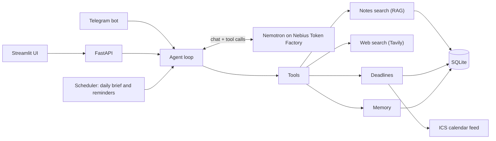

# 🎓 StudyPilot

**A private, always-on study and career assistant that remembers you, reads your notes and keeps you on schedule.**

Built for the **Nebius x NVIDIA Global AI Hackathon 2026** (Personal AI track) with **NVIDIA Nemotron** running on **Nebius Token Factory**.

| Light | Dark |
|---|---|
|  |  |

## The problem

Students and early-career engineers juggle notes, exam dates, interview prep and career goals across a dozen apps.
Generic chatbots forget everything between sessions and don't know your syllabus or your calendar.

## What StudyPilot does

It is a personal AI that gets more useful the longer you use it:

- **Remembers you.** It picks up your goals, course, skills and preferences from normal conversation and stores them in a memory you can read, edit and delete.
- **Reads your notes.** Upload PDFs, text or Markdown. It answers from them (RAG) and cites the source file.
- **Uses tools you control.** It searches your notes, searches the live web, and adds or completes deadlines on its own when you say "my DSA exam is on 30 November".
- **Has reusable skills.** `/brief`, `/plan <topic>`, `/career <goal>`, `/quiz <topic>`, `/summarize <topic>`.
- **Works in the background.** A daily brief every morning and a reminder two days before each deadline, in the app and on Telegram.
- **Lives where you are.** Web UI (light and dark) and a private Telegram bot. Deadlines sync to Google, Apple or Outlook Calendar through an ICS feed.

All replies are in clear English.

## How it uses Nebius and NVIDIA

| Piece | Technology |
|---|---|
| Reasoning, chat, tool calling | **NVIDIA Nemotron** (default `nvidia/nemotron-3-super-120b-a12b`) |
| Model serving | **Nebius Token Factory**, via its OpenAI-compatible API |
| Notes search | Embeddings from Token Factory (`Qwen/Qwen3-Embedding-8B`), keyword fallback |
| Live web search | Tavily |
| Deployment | Docker image for **Nebius Serverless** |

The model is chosen with one line in `.env` (`LLM_MODEL=`) and can be changed from the in-app Settings tab.

## Architecture



How a message flows: the agent builds a prompt from your relevant memories and recent chat, lets Nemotron decide
which tools to call (up to 5 steps), runs them, and returns the final answer. It then extracts any new long-term facts
about you and stores them.

## Quick start

```bash
python -m venv .venv
source .venv/bin/activate          # Windows: .venv\Scripts\activate
pip install -r requirements.txt
cp .env.example .env               # Windows: copy .env.example .env
```

Edit `.env`:

```
NEBIUS_API_KEY=your_nebius_key
LLM_MODEL=nvidia/nemotron-3-super-120b-a12b
TAVILY_API_KEY=your_tavily_key
```

Verify everything (key, model name, tool calling, embeddings):

```bash
python check_setup.py
```

Run it in two terminals:

```bash
uvicorn app.main:app --port 8000
streamlit run ui.py
```

Open http://localhost:8501.

**Full guide** (Windows steps, model choices, Telegram, calendar, troubleshooting): [SETUP.md](SETUP.md)

## Project structure

```
app/
  main.py          FastAPI endpoints
  agent.py         Tool-calling agent loop and system prompt
  llm.py           Nebius Token Factory client (OpenAI-compatible)
  tools.py         search_notes, web_search, deadlines, remember
  memory.py        Long-term memory (extract, store, retrieve)
  rag.py, vec.py   Notes ingestion and retrieval
  skills.py        /brief /plan /career /quiz /summarize
  scheduler.py     Daily brief and deadline reminders
  telegram_bot.py  Private Telegram bot
  calendar_ics.py  ICS feed and import
  settings.py      In-app settings (model, brief time, theme)
ui.py              Streamlit interface
check_setup.py     Setup self-test
tests/             pytest suite (no API key needed)
Dockerfile         For Nebius Serverless
```

## Privacy

- Your data stays in a local SQLite file. Nothing is sent anywhere except the prompts to Nebius and search queries to Tavily.
- Secrets live only in `.env`, which is git-ignored. The app shows whether a key is set, never its value.
- The Telegram bot is private: the first chat to message it becomes the owner, and others are refused.
- You can delete memories and clear chat history, notes and notifications from the Settings tab.

## Deploy

The hackathon needs a public demo URL. Follow **[DEPLOY.md](DEPLOY.md)**: it covers Nebius Serverless and any Docker host.

```bash
docker build -t studypilot .
docker run -p 8501:8501 --env-file .env studypilot
```

Open http://localhost:8501. Only the UI port is public; the API stays inside the container.

## Tests

```bash
pytest -q
```

## Limitations and next steps

- Single user, no login. Put it behind your own access control if you deploy it publicly.
- SQLite suits a single instance. Multiple users would need a shared database.
- Calendar sync is one-way (app to calendar) plus ICS import. Two-way Google Calendar sync would need OAuth.
- Next: voice input, spaced-repetition flashcards generated from notes, and Google Calendar OAuth.

## License

[MIT](LICENSE)

## Acknowledgements

Built with [NVIDIA Nemotron](https://www.nvidia.com/en-us/ai-data-science/foundation-models/nemotron/) on
[Nebius Token Factory](https://tokenfactory.nebius.com/), [Tavily](https://tavily.com/),
[FastAPI](https://fastapi.tiangolo.com/) and [Streamlit](https://streamlit.io/).
